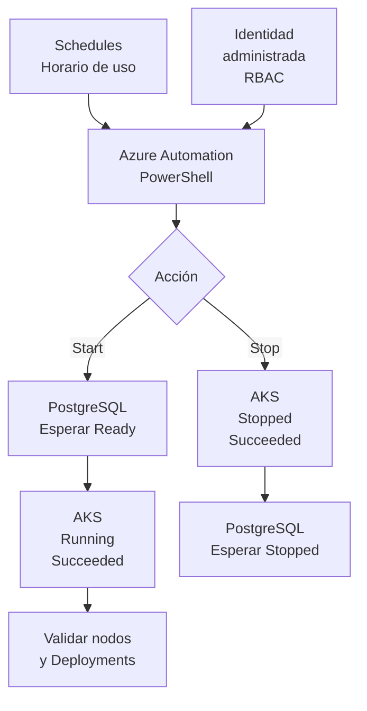

# Automatización horaria de AKS y PostgreSQL en Azure

Runbook en PowerShell para iniciar y detener un ambiente de testing según su horario de uso. Coordina AKS y PostgreSQL Flexible Server, espera sus estados y comprueba nodos y Deployments antes de finalizar el inicio.

Desarrollé y validé la automatización en testing. Este repositorio contiene una **versión simplificada y anonimizada**: conserva el diseño y sus decisiones operativas sin publicar recursos, credenciales ni registros internos.

## Problema y solución

Mantener el ambiente encendido fuera de uso genera consumo de cómputo innecesario. Detener PostgreSQL antes que las aplicaciones, o iniciar AKS sin que la base esté lista, agrega fallas de dependencia.

Azure Automation ejecuta el flujo fuera del clúster: un AKS detenido no puede ejecutar el CronJob que lo vuelve a iniciar. La identidad administrada permite autenticar sin incluir contraseñas en el código.



## Qué implementa

| Componente | Alcance |
|---|---|
| Orden de operación | PostgreSQL → AKS al iniciar; AKS → PostgreSQL al detener. |
| Estados | Consulta antes de actuar y espera transiciones conocidas. |
| Reintentos | Carga de módulos, flujo de inicio y errores transitorios de PostgreSQL. |
| Validación Kubernetes | `kubectl wait` para nodos y Deployments mediante AKS Run Command. |
| Diagnóstico | Estados, warnings y listado de Deployments/pods en los streams del job. |
| Autenticación | Identidad administrada y selección de suscripción. |

La validación Kubernetes no prueba HTTP, SQL ni transacciones de negocio. El script tampoco crea la Automation Account, los roles, los schedules o los recursos Azure.

## Estructura y ruta de lectura

```text
automatizacion-costos-azure/
├── automatizacion-horaria.ps1   # Funciones, parámetros y punto de entrada
├── docs/
│   ├── arquitectura.md         # Estados, esperas y decisiones
│   ├── operacion.md            # Configuración y recuperación
│   └── validacion.md           # Evidencia y matriz de pruebas
└── README.md
```

1. Revisa [arquitectura](docs/arquitectura.md).
2. Prepara el entorno con la [guía de operación](docs/operacion.md).
3. Ejecuta una prueba manual y registra resultados con la [guía de validación](docs/validacion.md).
4. Habilita recurrencia después de comprobar inicio, detención y recuperación.

## Requisitos

- AKS y PostgreSQL Flexible Server existentes, autorizados para detenerse.
- Automation Account con identidad administrada y runtime PowerShell compatible.
- Módulos `Az.Accounts`, `Az.Aks` y `Az.PostgreSql`. Registrar y probar versiones juntas; esta copia no fija una combinación validada.
- RBAC sobre ambos recursos y acceso a AKS Run Command compatible con las restricciones del clúster.
- Namespace existente con los Deployments que se desea comprobar.
- Ventana aprobada y revisión de consumidores externos de la base de datos.

El runbook usa cmdlets Az. Azure CLI es una herramienta opcional para las comprobaciones manuales de la documentación. `Connect-AzAccount -Identity` requiere un runtime Azure con identidad administrada; no funciona como login interactivo de un PC local.

## Parámetros y ejecución

| Parámetro | Valor |
|---|---|
| `Action` | `Start` o `Stop`; obligatorio. |
| `SubscriptionName` | Nombre o ID de la suscripción autorizada. |
| `AksResourceGroup`, `AksName` | Grupo y nombre del AKS existente. |
| `PostgreSqlResourceGroup`, `PostgreSqlName` | Grupo y nombre de PostgreSQL. |
| `AppNamespace` | Namespace válido, existente y confiable. |

Reemplazar todos los marcadores. `AppNamespace` se interpola en shell y no debe recibir texto externo arbitrario.

Ejemplo con nombres ficticios, para un runtime autorizado:

```powershell
.\automatizacion-horaria.ps1 `
  -Action Start `
  -SubscriptionName 'demo-subscription' `
  -AksResourceGroup 'rg-demo-aks' `
  -AksName 'aks-demo' `
  -PostgreSqlResourceGroup 'rg-demo-db' `
  -PostgreSqlName 'pg-demo' `
  -AppNamespace 'demo-app'
```

Para detener, usar los mismos recursos con `-Action Stop`. La ejecución modifica su estado y disponibilidad.

## Evidencia disponible

El caso de referencia registra el ciclo manual Start/Stop, comprobación Kubernetes, habilitación de schedules y corrección de una falla de carga de módulos. Los logs internos no se publican.

Esta copia no incluye evidencia pública de una nueva ejecución en una suscripción propia ni una suite con mocks. La [matriz de validación](docs/validacion.md) separa los antecedentes del caso de las comprobaciones reproducibles por terceros.

## Medición de costos

El objetivo es reducir horas de cómputo fuera de uso. Almacenamiento, respaldos y otros recursos pueden continuar generando cargos.

La documentación original registra aproximadamente USD 12 por un día encendido y USD 2,65 por un fin de semana detenido. Son observaciones preliminares de períodos distintos, sin export público: no demuestran ahorro mensual ni causalidad exclusiva del runbook.

Comparar períodos equivalentes, mismo alcance, moneda y métrica en Azure Cost Management. Registrar también horas de uso y otros cambios de infraestructura.

## Límites y mejoras pendientes

- No hay bloqueo entre jobs: evitar superponer Start y Stop.
- Los deadlines limitan observación, no la duración estricta de los cmdlets ni del job.
- No hay rollback automático; un inicio fallido puede dejar recursos activos para diagnóstico.
- No se comprueban todos los tipos de workload ni consumidores externos.
- El matching de algunos errores por texto puede requerir adaptación.
- Los roles integrados del caso son más amplios que permisos mínimos de Start/Stop.

Pendientes: validación automática de parámetros, aislamiento explícito del contexto Azure, pruebas con mocks, exclusión entre jobs, validación funcional y evidencia pública de costos. No son características ya implementadas.

**Tecnologías:** PowerShell, Azure Automation, AKS/Kubernetes, PostgreSQL Flexible Server, identidad administrada, RBAC y Azure Cost Management.
